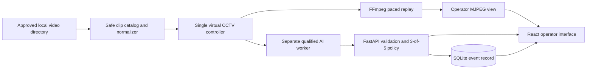

# Sentinel AI

**Intelligent Web-Based CCTV Monitoring and Violence Alert System**

Sentinel AI is an academic web application that presents approved prerecorded video as one looping virtual CCTV source, analyzes the same source with a frozen violence/fighting model, and shows an operator-visible alert when the qualified temporal criterion is met. It addresses the need for a reproducible, reviewable surveillance demonstration without claiming access to a physical CCTV installation or production deployment.

The current release is the final scoped submission for **MDI3001 — Advanced Web Technologies** at **Vellore Institute of Technology, Vellore**, School of Computer Science and Engineering (SCOPE). Its implemented workflow is deliberately narrow: one virtual camera, genuine frozen inference, SQLite event persistence, and a truthful operator interface.

- Repository: [github.com/kasinathca/sentinel-ai](https://github.com/kasinathca/sentinel-ai)
- GitHub username: [`kasinathca`](https://github.com/kasinathca)
- Current scope decision: [Academic violence demo scope](docs/22-academic-violence-demo-scope.md)
- Executed acceptance evidence: [Review readiness and acceptance](docs/24-review-readiness-and-acceptance.md)

## Team

| Registration number | Student name | Institutional email | Responsibility |
|---|---|---|---|
| 24MID0121 | AADITI RAJNEESH POTEY | aaditi.rajneesh2024@vitstudent.ac.in | Frontend Development |
| 24MID0124 | KASINATH C A | kasinath.ca2024@vitstudent.ac.in | Project Lead, AI/ML and Integration |
| 24MID0166 | GOURI SHIVA | gouri.shiva2024@vitstudent.ac.in | Backend Development |

## Implemented features

- One canonical virtual CCTV camera, `DEMO-CAM-01`, backed by an approved local video directory.
- Safe top-level media discovery using opaque clip IDs; browser APIs do not receive filesystem paths.
- FFprobe inspection and background FFmpeg normalization to a canonical 1280×720, H.264, yuv420p, constant-30-FPS MP4 when required.
- Start, stop, restart, naturally paced MJPEG playback, and automatic looping without treating EOF as camera failure.
- Separate frozen AI worker using the qualified I3D extractor and temporal BiGRU-attention model.
- Shared source/session identity for displayed video and analyzed video.
- Backend validation, frozen `0.906` score threshold, complete latest-five history, and 3-of-5 temporal qualification.
- At most one persisted violence event per active source session, with stale-session rejection.
- React operator interface with source controls, video, AI state, score diagnostics, event history, and a qualified fighting alert driven by actual model output.
- Explicit degraded/error states for unavailable FFmpeg, corrupt media, missing model assets, worker failures, and database readiness failures.

Authentication, roles, physical CCTV/RTSP/ONVIF, multiple cameras, tracking, intrusion, loitering, crowd detection, evidence storage, acknowledgement, WebSockets, cloud deployment, and production analytics are outside this academic release.

## Technology stack

| Layer | Implemented technology |
|---|---|
| Frontend | React 19, Vite, JavaScript, CSS |
| Backend | Python, FastAPI, Uvicorn, Pydantic |
| Persistence | SQLAlchemy, Alembic, SQLite for the qualified local runtime |
| AI/ML | PyTorch temporal BiGRU-attention classifier; exact MMAction2 I3D ResNet-50 non-local feature extractor |
| Video | FFmpeg/FFprobe, MJPEG delivery, canonical media normalization |
| Verification | Python `unittest`, Node test runner, Oxlint, Vite production build, PowerShell integration gate |

## Architecture



The controller supplies the same catalog-resolved file and source-session UUID to replay and inference. The backend, not the UI or worker, applies the temporal criterion and owns event persistence.

## Repository structure

```text
sentinel-ai/
├── ai_worker/                 # Frozen violence runtime integration and tests
├── backend/                   # FastAPI modular monolith, migrations, seed, tests
├── frontend/                  # React/Vite operator application and view-model tests
├── docs/                      # Scope, architecture, qualification, runbooks, evidence
├── scripts/                   # Repository verification and branch checks
├── .env.example               # Documented machine-local configuration keys
├── launch_sentinel_demo.cmd   # Owned Windows full-demo launcher
└── README.md                  # Setup, execution, demo, and project overview
```

Model checkpoints, source videos, datasets, generated media, local databases, virtual environments, logs, and secrets are intentionally excluded from Git.

## Prerequisites

### Basic web application

- Windows 10 or 11 with PowerShell.
- Git.
- Python 3.12 for the backend/application environment.
- Node.js `^20.19.0` or `>=22.12.0` and npm, as required by the committed Vite toolchain.
- FFmpeg and FFprobe on `PATH`, or their absolute executable paths supplied through environment variables, for video ingest and playback.

The backend, database, frontend, and pure/unit tests can run without the external model workspace. Starting real AI processing cannot.

### Full AI-powered demonstration

In addition to the basic requirements:

- A CUDA-capable NVIDIA environment matching the qualified runtime.
- The external XD-Violence workspace and exact extractor sources/artifacts described in [Qualified runtime staging setup](docs/25-qualified-runtime-staging-setup.md).
- The frozen temporal checkpoint and I3D weights with the recorded SHA-256 values.
- A qualified Python 3.10.11 temporal environment and the separate exact-extractor environment.
- Approved fighting-like and non-fighting source videos stored outside Git.

Do not substitute a different checkpoint, extractor, threshold, or nearby dependency version and claim qualification. If the artifacts cannot be validated, treat real AI execution as blocked.

## Installation and basic execution

The following commands are intended for Windows PowerShell. Choose any local parent directory; no developer-specific project path is required.

### 1. Clone the repository

```powershell
git clone https://github.com/kasinathca/sentinel-ai.git
Set-Location .\sentinel-ai
```

### 2. Create the backend virtual environment

```powershell
py -3.12 -m venv .venv
Set-ExecutionPolicy -Scope Process Bypass -Force
.\.venv\Scripts\Activate.ps1
python -m pip install --upgrade pip
python -m pip install -r .\backend\requirements-dev.txt
```

### 3. Install frontend dependencies

```powershell
Set-Location .\frontend
npm ci
Set-Location ..
```

### 4. Configure local paths

Create an approved media directory outside the repository and set the runtime variables in every terminal that needs them:

```powershell
$mediaRoot = Join-Path $env:USERPROFILE "Sentinel-Demo-Media"
New-Item -ItemType Directory -Force -Path $mediaRoot | Out-Null

$env:SENTINEL_DEMO_MEDIA_ROOT = $mediaRoot
$env:SENTINEL_FFMPEG_BINARY = (Get-Command ffmpeg.exe).Source
$env:SENTINEL_FFPROBE_BINARY = (Get-Command ffprobe.exe).Source
$env:VITE_API_PROXY_TARGET = "http://127.0.0.1:8000"
```

The default SQLite file is repository-relative at `backend/runtime/sentinel.db`. Set `SENTINEL_DATABASE_URL` only when an explicit alternative is required.

### 5. Initialize and check the database

```powershell
$env:PYTHONPATH = (Resolve-Path ".\backend").Path
.\.venv\Scripts\python.exe .\backend\scripts\init_database.py
.\.venv\Scripts\python.exe .\backend\scripts\check_database.py
```

### 6. Start the backend

```powershell
$env:PYTHONPATH = (Resolve-Path ".\backend").Path
.\.venv\Scripts\python.exe -m uvicorn app.main:app `
  --app-dir .\backend --host 127.0.0.1 --port 8000
```

Verify liveness and database readiness in another PowerShell terminal:

```powershell
Invoke-RestMethod http://127.0.0.1:8000/api/v1/health
Invoke-RestMethod http://127.0.0.1:8000/api/v1/health/readiness
```

### 7. Start the frontend

```powershell
Set-Location .\frontend
$env:VITE_API_PROXY_TARGET = "http://127.0.0.1:8000"
npm run dev -- --host 127.0.0.1 --port 5173 --strictPort
```

Open [http://127.0.0.1:5173](http://127.0.0.1:5173). The basic application can be inspected without model assets, but real inference will report unavailable until the qualified runtime is configured.

## AI model setup

Keep the XD-Violence workspace, model weights, extractor weights, virtual environments, and source media outside this repository. Configure the external runtime explicitly:

```powershell
$env:SENTINEL_VIOLENCE_ROOT = "<absolute-path-to-qualified-XD-Violence-workspace>"
$env:SENTINEL_AI_PYTHON = "<absolute-path-to-qualified-temporal-python.exe>"
$env:SENTINEL_DEMO_MEDIA_ROOT = "<absolute-path-to-approved-video-directory>"
$env:SENTINEL_FFMPEG_BINARY = "<absolute-path-to-ffmpeg.exe>"
$env:SENTINEL_FFPROBE_BINARY = "<absolute-path-to-ffprobe.exe>"
```

Optional layout overrides are supported for qualified installations that preserve the exact artifacts:

```text
SENTINEL_TEMPORAL_CHECKPOINT
SENTINEL_TEMPORAL_TRAIN_SCRIPT
SENTINEL_EXTRACTOR_PYTHON
SENTINEL_EXTRACTOR_WORKER
SENTINEL_RUNTIME_WORK_DIR
```

Validate hashes, source revisions, environment versions, CUDA availability, and approved fixtures:

```powershell
powershell -NoProfile -ExecutionPolicy Bypass `
  -File .\ai_worker\scripts\verify_qualified_runtime.ps1 `
  -XDViolenceRoot $env:SENTINEL_VIOLENCE_ROOT `
  -TemporalPython $env:SENTINEL_AI_PYTHON
```

Then run the real worker preflight:

```powershell
$env:PYTHONPATH = (Resolve-Path ".\ai_worker").Path
& $env:SENTINEL_AI_PYTHON -m sentinel_violence_runtime.cli `
  --root $env:SENTINEL_VIOLENCE_ROOT `
  --source-map .\ai_worker\examples\source_map.example.json `
  --preflight-only
```

For the complete configured demonstration, start the owned launcher:

```powershell
.\launch_sentinel_demo.cmd
```

The launcher validates the model/runtime, initializes the database, starts loopback-only backend and frontend processes, opens the browser, and cleans up only processes it owns. Press `Ctrl+C` in its console for safe shutdown.

## Demonstration procedure

1. Place approved supported videos (`.mp4`, `.mov`, `.m4v`, `.mkv`, `.avi`, or `.webm`) directly in `SENTINEL_DEMO_MEDIA_ROOT`.
2. Start the configured application and open **Camera Monitoring**.
3. Select **Refresh Videos**. Wait for any required normalization to reach **Ready**.
4. Select a non-fighting clip, choose **Start**, confirm paced playback, and observe genuine model windows without a qualified event.
5. Choose **Stop**, select the fighting-like clip, and choose **Start** again.
6. Confirm the displayed feed and AI status share the active source/session and that a red alert appears only after actual output satisfies threshold `0.906` in at least 3 of the latest 5 complete observations.
7. Let the source reach EOF and verify playback loops without an offline state.
8. Use **Restart** to replay within the current session, then **Stop** to end playback and AI processing.

Clip names are not labels and do not influence inference. A failed worker is not a negative prediction. The detailed reviewer sequence and historical observed evidence are in [docs/24-review-readiness-and-acceptance.md](docs/24-review-readiness-and-acceptance.md).

## Testing

Run the repository integration gate from the root:

```powershell
powershell -NoProfile -ExecutionPolicy Bypass `
  -File .\scripts\verify_integration.ps1
```

Individual checks:

```powershell
# Backend
$env:PYTHONPATH = (Resolve-Path ".\backend").Path
.\.venv\Scripts\python.exe -m unittest discover `
  -s .\backend\tests -p "test_*.py" -v

# AI-worker pure/unit tests (does not prove raw-video inference)
$env:PYTHONPATH = (Resolve-Path ".\ai_worker").Path
.\.venv\Scripts\python.exe -m unittest discover `
  -s .\ai_worker\tests -p "test_*.py" -v

# Frontend
Set-Location .\frontend
npm test
npm run lint
npm run build
npm audit
Set-Location ..

# Git whitespace errors
git diff --check
```

Raw-video inference and GPU preflight are intentionally separate because they require the external qualified workspace. Do not report them as passed unless they were executed on that environment.

## Verified results

The frozen Fighting-vs-Normal temporal model is `MODEL-VIO-BIGRU-ATTN-XD-V1` (`model_version_id` `6d22f83d-17f8-5ecf-9f0f-246fa326ec72`). Its checkpoint SHA-256 is `1fa01d1be82ab3c63d33b4d5f1d5ef4ab2a176d1d2842afc842955ff72896772`.

The one-time held-out live-policy evaluation recorded F1 `0.826923`, precision `0.851485`, positive-video coverage `0.803738`, and a Normal-video false-event rate of `0.050000`. These are frozen experiment results, not guarantees for new footage. The full dataset, metric, extractor, hardware, and no-retuning provenance is in [Violence model and runtime qualification](docs/19-violence-model-and-runtime-qualification.md).

Integrated acceptance on 8–9 October 2026 verified real FFmpeg playback, the exact extractor and frozen checkpoint, positive/negative fixtures, SQLite persistence, browser alert rendering, stop/restart, looping, and explicit failure states. Those are historical executed results; running the test commands above produces a separate current verification record.

## Limitations

- This is a local academic prototype using prerecorded footage as a virtual CCTV feed, not a physical or production CCTV installation.
- It supports one logical camera and binds demo services to loopback.
- Model scores are uncalibrated fighting-class sigmoid outputs, not universal probabilities of real-world violence.
- The strict dataset uses weak video-level labels; exact fight-onset localization is not established.
- Behavior on new sites, camera angles, lighting, occlusion, cultures, or unseen video distributions is not guaranteed.
- The release has no authentication, role authorization, RTSP/ONVIF, multiple cameras, evidence pipeline, acknowledgement workflow, cloud deployment, or production hardening.
- External model/media licensing and access must be handled separately; large or restricted artifacts are not redistributed here.

## Documentation

- [Academic release scope](docs/22-academic-violence-demo-scope.md)
- [Review readiness and executed acceptance](docs/24-review-readiness-and-acceptance.md)
- [Qualified runtime staging setup](docs/25-qualified-runtime-staging-setup.md)
- [Violence model and runtime qualification](docs/19-violence-model-and-runtime-qualification.md)
- [Virtual CCTV replay integration](docs/21-virtual-cctv-replay-integration.md)
- [Deployment and demo runbook](docs/16-deployment-guide.md)
- [Operator manual](docs/17-operator-manual.md)
- [Backend reference](backend/README.md)
- [AI-worker reference](ai_worker/README.md)
- [Frontend reference](frontend/README.md)

## References

- [XD-Violence official project page](https://roc-ng.github.io/XD-Violence/)
- [Jia-Herng inappropriate-video-detection feature extractor](https://github.com/hongjiaherng/inappropriate-video-detection)
- [MMAction2](https://github.com/open-mmlab/mmaction2)
- [FastAPI documentation](https://fastapi.tiangolo.com/)
- [FFmpeg documentation](https://ffmpeg.org/documentation.html)

This repository does not include a separate project report; the academic report is maintained as a separate deliverable.
